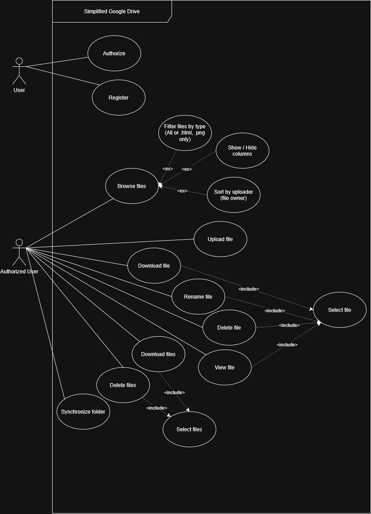
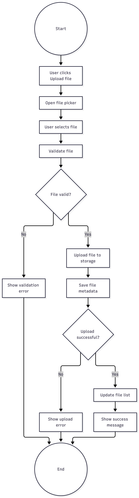
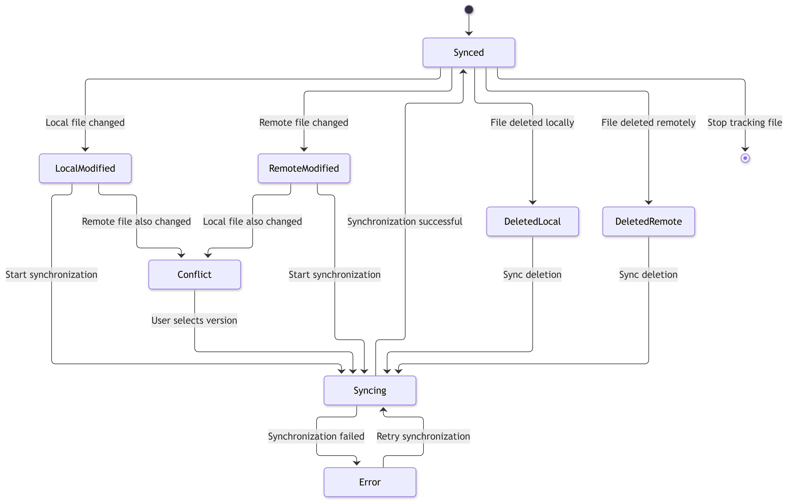
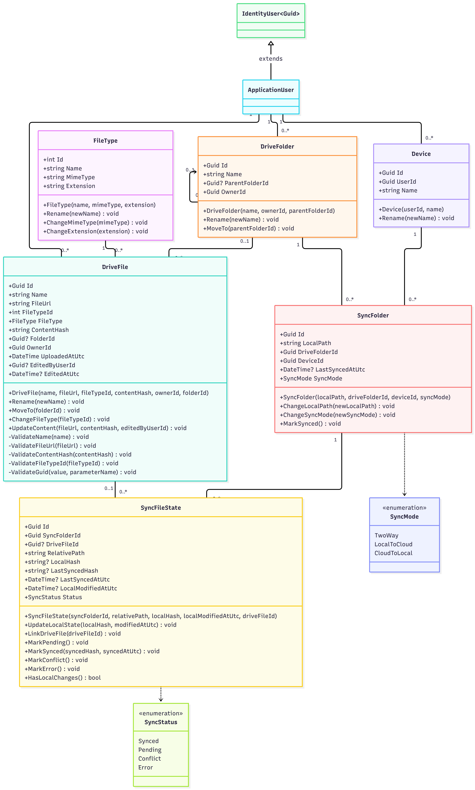
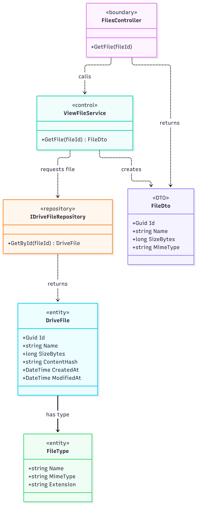
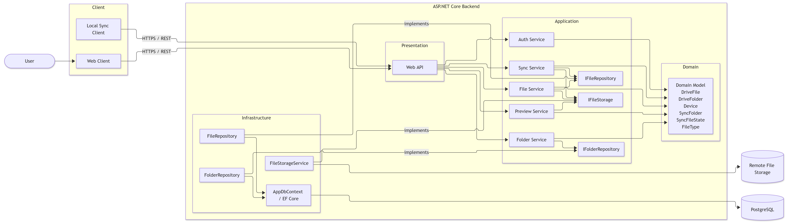
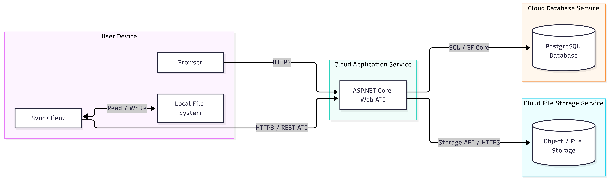
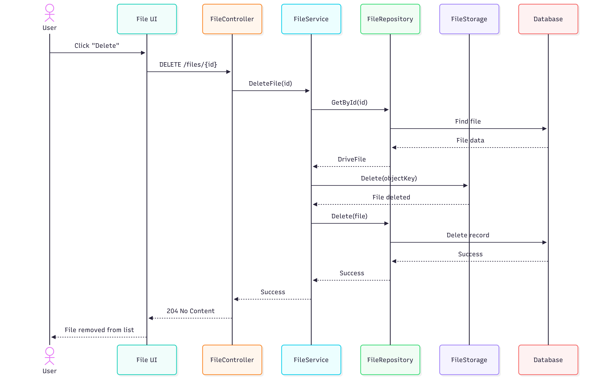
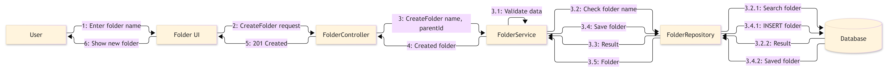

# GDriveLight UML

The UML specification of GDriveLight: nine diagrams covering user workflows, the domain model, object interactions, synchronization, and deployment.

[Project overview](../README.md) · [Diagram files](diagrams/)

> **Design snapshot**
>
> These diagrams capture the initial design. The implementation has since evolved: local synchronization state is stored in the desktop client's SQLite database as `LocalItemState`, while the server maintains a change log. References to `SyncFileState` describe the earlier design. Service names in the diagrams represent responsibilities now implemented through CQRS handlers and infrastructure services.

## Diagram index

| Diagram | What it describes |
| --- | --- |
| [Use cases](diagrams/01-use-case.png) | User roles and file management capabilities |
| [Domain classes](diagrams/02-domain-classes.png) | Entities, relationships, and synchronization concepts |
| [View file VOPC](diagrams/03-view-file-vopc.png) | Classes participating in the file viewing use case |
| [Upload activity](diagrams/04-upload-activity.png) | File selection, validation, storage, and outcomes |
| [Delete file sequence](diagrams/05-delete-file-sequence.png) | Ordered calls between the UI, API, storage, and database |
| [Create folder communication](diagrams/06-create-folder-communication.png) | Collaborating objects and numbered messages |
| [Synchronization states](diagrams/07-sync-state.png) | Local changes, remote changes, conflicts, and retries |
| [Components](diagrams/08-components.png) | Client applications, backend layers, and dependencies |
| [Deployment](diagrams/09-deployment.png) | Client devices, the hosted API, database, and file storage |

## User workflows

Expand a diagram to view it inline. Select an image to inspect the full-resolution file.

<strong>01 · Use cases</strong> — what users can do

The system boundary and user roles, including authentication, browsing, file operations, filtering, sorting, and synchronization.

<strong>04 · Upload activity</strong> — from file selection to storage

The upload workflow, including validation, saving content and metadata, and handling success or failure.

<strong>07 · Synchronization states</strong> — changes and recovery

The conceptual synchronization lifecycle, with transitions for local and remote edits, deletions, conflicts, and retrying failed synchronization.

## Structure and architecture

<strong>02 · Domain classes</strong> — the core data model

Users, files, folders, file types, devices, and their relationships, together with the original synchronization model.

<strong>03 · View file VOPC</strong> — participating classes

A View of Participating Classes for viewing a file: the API boundary, coordinating service, repository, domain entities, and response DTO.

<strong>08 · Components</strong> — application boundaries

The desktop and web clients, the backend's architectural layers, and its persistence and file storage dependencies.

<strong>09 · Deployment</strong> — where the system runs

The client device, local filesystem, hosted ASP.NET Core API, PostgreSQL database, and remote file storage, connected through their respective protocols.

## Object interactions

<strong>05 · Delete file sequence</strong> — calls in order

The sequence of interactions required to locate a file, remove its stored content and metadata, and return the result to the user interface.

<strong>06 · Create folder communication</strong> — collaborating objects

Numbered messages between the user interface, controller, coordinating service, repository, and database during folder creation.

